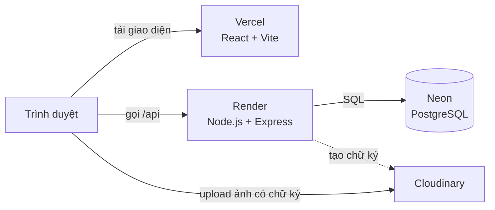
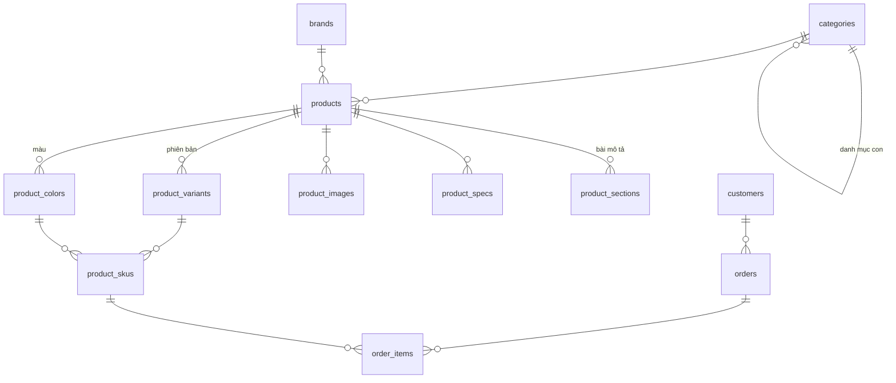

# DH tech

> Công nghệ đến gần bạn hơn.

Website bán điện thoại, laptop và phụ kiện, làm full-stack từ đầu: giao diện cho khách, trang quản trị cho admin, API và cơ sở dữ liệu riêng.

🌐 **Website:** https://dhtech.id.vn
⚙️ **API:** https://dh-tech-api.onrender.com/api/health


<!--
Ảnh giao diện: chụp rồi lưu vào docs/screenshots/ với tên trang-chu.png, chi-tiet.png,
dien-thoai.png, admin.png, sau đó xoá hai dòng chú thích này để bảng ảnh hiện ra.

## Giao diện

| Trang chủ | Chi tiết sản phẩm |
|---|---|
|  |  |

| Trên điện thoại | Trang quản trị |
|---|---|
|  |  |
-->

## Tính năng

**Khách hàng**
- Trang chủ có video giới thiệu tự đổi theo thời gian, deal tuần dạng bento, linh vật Mèo Cam
- Danh mục Điện thoại, Laptop, Phụ kiện (có danh mục con), lọc theo hãng và khoảng giá, sắp xếp theo giá
- Tìm kiếm gõ đến đâu tìm đến đó
- Trang chi tiết: nhiều ảnh cho từng màu, chọn phiên bản và màu, bài mô tả, báo "Sắp về hàng" khi hết
- Tài khoản khách hàng: đăng ký, đăng nhập (kéo dây đèn để mở form), xem lại đơn và trạng thái giao
- Giỏ hàng lưu trên trình duyệt; mua được cả khi chưa đăng nhập
- Giao diện responsive cho điện thoại, có chế độ tối

**Quản trị (`/admin`)**
- Đăng nhập bằng JWT, khoá tạm 15 phút sau 5 lần nhập sai
- Thêm, sửa, xoá sản phẩm: phiên bản, màu, tồn kho từng SKU, thông số, ảnh
- Upload ảnh thẳng lên Cloudinary bằng chữ ký do server tạo
- Soạn bài mô tả sản phẩm (tiêu đề, nội dung, ảnh)
- Xem đơn hàng, đổi trạng thái; huỷ đơn thì hàng tự trả về kho; đánh dấu đơn của khách thành viên

## Kiến trúc



Mỗi lần merge vào nhánh `main`, Vercel và Render tự build và deploy lại.

## Thiết kế database



- **SKU = phiên bản × màu.** Tồn kho nằm ở `product_skus`, vì iPhone 256GB màu Bạc có thể hết hàng trong khi màu Đen vẫn còn. Khoá ngoại ghép đảm bảo phiên bản và màu thuộc cùng một sản phẩm.
- **`order_items` lưu lại tên và giá lúc đặt**, nên sau này sửa giá hay xoá sản phẩm thì đơn cũ vẫn giữ nguyên.

## Bảo mật và tính đúng đắn

- Server tự tính lại giá từ database, không tin giá do trình duyệt gửi lên
- Đặt hàng chạy trong **transaction** và khoá dòng (`SELECT … FOR UPDATE`): hai người cùng mua món cuối cùng thì chỉ một người thành công, kho không bị âm
- Mọi câu SQL dùng tham số (`$1, $2…`) để chống SQL injection
- Mật khẩu (admin và khách) băm bằng bcrypt; đăng nhập sai nhiều lần bị khoá tạm theo IP
- Token JWT của khách và admin tách riêng bằng `audience`: token khách không dùng được cho API quản trị
- CORS chỉ cho phép domain của website; lỗi trả về không lộ chi tiết bên trong
- Thông tin bí mật nằm trong biến môi trường, file `.env` không đưa lên GitHub

## Cấu trúc thư mục

```
dh-tech/
├── frontend/     React + Vite: trang khách và trang admin   → frontend/README.md
├── backend/      Node.js + Express: REST API                 → backend/README.md
├── database/     schema.sql, dữ liệu mẫu, câu truy vấn luyện tập
├── docs/         Ảnh chụp giao diện
├── brand/        Logo gốc
└── prototype/    Bản giao diện HTML đầu tiên
```

## Chạy trên máy

Cần Node.js 22 trở lên và một database PostgreSQL (ví dụ Neon gói miễn phí).

```powershell
# 1. Tạo bảng và dữ liệu mẫu: chạy lần lượt trong SQL Editor của Neon
#    database/schema.sql → database/seed.sql → database/seed-mo-rong.sql
#    (database đang chạy từ bản cũ: chạy thêm các file trong database/migrations theo thứ tự)

# 2. Backend
cd backend
copy .env.example .env      # rồi điền DATABASE_URL, JWT_SECRET, CLOUDINARY_*
npm install
npm run create-admin -- admin "mat-khau-it-nhat-10-ky-tu"
npm run dev                 # http://localhost:3000

# 3. Frontend (mở terminal khác)
cd frontend
npm install
npm run dev                 # http://localhost:5173
```

## Lộ trình

- [x] Giao diện prototype theo bộ nhận diện DH tech
- [x] Thiết kế database PostgreSQL trên Neon
- [x] Backend API cho khách: sản phẩm, danh mục, đặt hàng
- [x] Giao diện React nối API thật
- [x] Trang admin: JWT, quản lý sản phẩm, upload ảnh, quản lý đơn
- [x] Deploy Vercel + Render + Neon
- [x] Tài khoản khách hàng, đơn hàng của tôi
- [x] Gắn tên miền riêng dhtech.id.vn
- [ ] Trang cài đặt website trong admin (khẩu hiệu, banner, hotline)
- [ ] Quên mật khẩu qua email, sửa thông tin cá nhân

## Ghi chú

Đây là dự án học tập. Giá niêm yết lấy theo giá chính hãng tại Việt Nam lúc mở bán; giá DH tech, khuyến mãi và tồn kho là dữ liệu mẫu. Website không nhận thanh toán thật.

Tác giả: [28thHidro](https://github.com/28thHidro) · Có dùng AI hỗ trợ trong quá trình làm.
